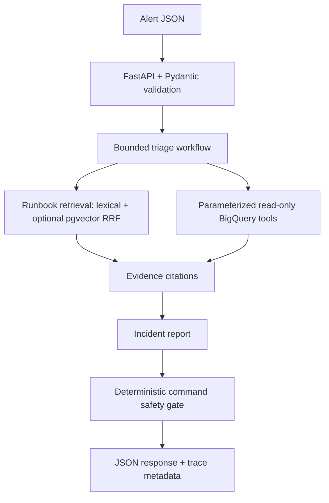

# SentinelOps

SentinelOps is an evidence-first cloud incident triage starter. It accepts an alert, searches local runbooks, returns traceable citations and diagnostic suggestions, and places every proposed command behind a deterministic safety policy. GCP, PostgreSQL/pgvector, Gemini, and Cloud Trace integrations are optional and require credentials and configuration.

> **Deployment status:** this repository is a deployable project scaffold, not a claim that a live GCP service, benchmark, trace, or production rollout already exists. The out-of-box triage path is local and clearly reports when telemetry/model integrations are unavailable.

## Start locally

Requirements: Python 3.11+.

```powershell
python -m venv .venv
.venv\Scripts\Activate.ps1
python -m pip install -e ".[dev]"
Copy-Item .env.example .env
$env:API_KEY = "local-dev-key"
uvicorn src.api.main:app --reload
```

Open `http://127.0.0.1:8000/docs`. Example request:

```powershell
Invoke-RestMethod http://127.0.0.1:8000/v1/triage `
  -Method Post -Headers @{"X-API-Key"="local-dev-key"} `
  -ContentType "application/json" `
  -Body '{"service":"checkout-api","summary":"503 spike and ERR_POOL_EXHAUSTED","severity":"SEV2"}'
```

Health endpoint: `GET /health`. Set `API_KEY` for API-key authentication; requests without the key are rejected when it is configured. In a deployed environment, set a strong secret through Secret Manager and never commit it.

## Architecture



## Safety and evidence

- The default path does not invoke an LLM and does not claim to have queried cloud telemetry. It returns a low-confidence, explicit `needs_evidence` report when runbook evidence does not support a cause.
- Proposed commands are suggestions only; SentinelOps never executes them. The Python allowlist admits a narrow set of diagnostics. Destructive, chained, and unknown commands require human approval.
- BigQuery service values use query parameters; only the project and dataset identifiers are interpolated from trusted deployment configuration. Use a read-only service account and dataset-level IAM.
- Citation IDs identify source file chunks. The critic helper can verify citations against retrieved evidence IDs before synthesis.
- Configure `OTEL_ENABLED=true` with GCP credentials to export spans. Cost is reported as zero only for the deterministic local path; provider billing is not estimated without known token counts and pricing.

## Optional integrations

Install `pip install -e ".[cloud]"` and configure `.env` (see `.env.example`). BigQuery reads expect `error_logs` and `recent_deployments` tables in `BIGQUERY_DATASET`. `src/pipelines/seed_bigquery.py` creates synthetic rows in those schemas (plus `service_metrics`) when run with appropriate permissions. Runbook ingestion reads local Markdown; GCS synchronization and persistent pgvector indexing are integration points to complete for a specific production environment.

The Gemini model names in `.env.example` are examples only and must be checked against models enabled for your project/region. The current implementation deliberately keeps inference optional rather than presenting mocked LLM output as real synthesis.

## Run locally with Postgres

```powershell
docker compose up --build
```

The compose profile starts Postgres with pgvector enabled. The local fallback remains usable without a database. Configure and implement a production embedding/index backend before claiming vector retrieval; current local retrieval is lexical and the RRF helper supports combining ranked sources.

## Evaluation

`evals/dataset/scenarios.jsonl` contains deterministic synthetic scenarios. `python -m evals.run_benchmark` evaluates the local retrieval/safety path against those cases; it does not benchmark hosted model quality, latency, or cost. Metrics are only valid for the environment actually measured. See `evals/judge.py` for citation and safety checks.

## Deploy to Cloud Run

1. Create a GCP project, enable Cloud Run, Artifact Registry, BigQuery, and Cloud Trace APIs, and configure billing/IAM.
2. Set Terraform variables and review `infra/main.tf`; apply from `infra/`.
3. Build and deploy the container with a strong API key provided as a Secret Manager secret. Restrict invoker IAM or place behind an authenticated gateway for production.
4. Configure the BigQuery dataset and tables, then seed synthetic data only in a non-production dataset.
5. Call `/health` and `/docs`, then submit a known alert and verify source IDs, trace export, auth, and safety decisions.

Terraform provisions foundational resources only. Review IAM, networking, secret bindings, budgets, log retention, and organization policy before production use.

## Repository map

```text
src/api/             FastAPI endpoints and strict schemas
src/agents/          Bounded triage, retrieval, telemetry and citation helpers
src/tools/           Hybrid retrieval, read-only BigQuery, safety policy
src/pipelines/       Synthetic BigQuery seed and runbook loader
src/observability/   Trace setup, metrics and state pruning
evals/               Synthetic scenarios and local evaluator
infra/               Cloud Run and GCP Terraform
tests/               Unit and API tests
```

## License

MIT. See [LICENSE](LICENSE).
